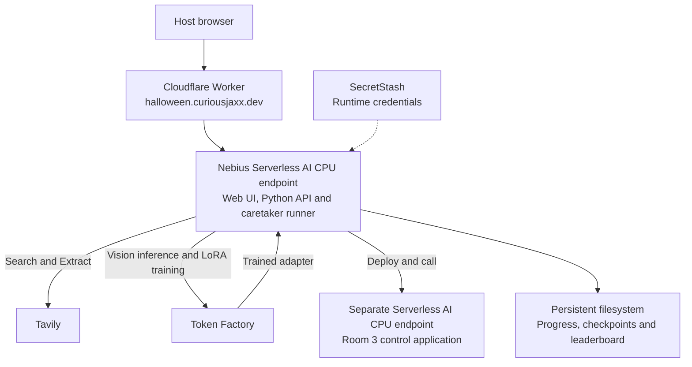

# Escape the Haunted Datacenter

A Halloween coding escape room for a 45-minute livestream: haunted infrastructure, questionable maintenance notes and three rooms to escape. One host controls the mouse and keyboard while friends or viewers help solve. Verified escapes earn a place on the persistent leaderboard.

**[Open the hosted demo](https://halloween.curiousjaxx.dev/)** — a host access code is required to control the game.

## Run locally

You need Python 3.12, the Nebius CLI authenticated to a project with Serverless AI access, and your own Tavily and Token Factory API keys. Your Token Factory account needs access to a vision model and fine-tuning.

1. Set up the project and download the caretaker's base model:

   ```sh
   git clone https://github.com/gogococo/haunted-datacenter.git
   cd haunted-datacenter
   python3 -m venv .venv
   source .venv/bin/activate
   pip install torch -r requirements-model.txt
   hf download Qwen/Qwen3-0.6B --local-dir models/base
   cp .env.example .env
   ```

2. Fill in `.env` with your API keys, Nebius project ID and subnet ID. Configure the Nebius CLI for that project with `nebius profile create` if needed. The Token Factory key does not authenticate AI Cloud deployments.

3. Start the caretaker model runner in this terminal:

   ```sh
   python caretaker_runner.py --base-dir models/base
   ```

4. From the repository directory in a second terminal, start the game:

   ```sh
   source .venv/bin/activate
   set -a
   source .env
   set +a
   python server.py
   ```

Open **http://127.0.0.1:8765**, enter a display name and click **Play**. Progress, checkpoints and scores are saved in the ignored `.runtime/` directory. Keep keys server-side and out of Git.

Playthroughs create real cloud resources. Resetting the game preserves scores and does not cancel training jobs or stop endpoints; manage those in Nebius. For Docker and cloud hosting, see the [deployment guide](deploy/README.md).

## The rooms

- **Room 1 — The Haunted Switchboard:** The old computer uses Tavily Search and Extract to research web sources as you untangle the ghosts' communications.
- **Room 2 — The NOC:** Use Token Factory vision to interpret camera images and LoRA fine-tuning to teach the AI caretaker how to respond.
- **Room 3 — The Generator Room:** Restore cooling through a pipe puzzle and deploy a control application on Nebius Serverless AI.

## Deployment architecture



Token Factory handles vision inference and training; the trained text model runs in the game's own model runner, inside the hosted app or on your computer during local play. Room 3's control service runs in a separate cloud endpoint. The building, broker traffic and sensor readings are simulated; the web research, model calls, training and cloud deployments are real.

Locally, the browser connects directly to the Python server, with the same external service integrations. The hosted release runs one host-controlled incident; shared co-op interactions are planned.
