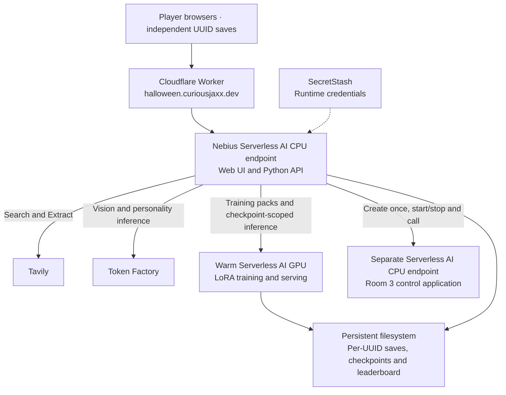

# Escape the Haunted Datacenter

A Halloween coding escape room for a 45-minute livestream: haunted infrastructure, questionable maintenance notes and three rooms to escape. One person controls each game while friends or viewers help solve; different players can keep separate games. Verified escapes earn a place on the persistent leaderboard.

**[Open the hosted demo](https://halloween.curiousjaxx.dev/)** — enter your name to start your own game. No host code is needed.

## Run locally

You need Python 3.12, Tavily and Token Factory API keys, and the Nebius CLI authenticated to your AI Cloud project. Start one warm training GPU using the [training setup](deploy/TRAINING.md); its private URL and token stay on the game server.

```sh
git clone https://github.com/gogococo/haunted-datacenter.git
cd haunted-datacenter
python3 -m venv .venv
source .venv/bin/activate
pip install tavily-cli==0.1.8
cp .env.example .env
# Fill in your keys, project/subnet and warm-worker settings.
set -a
source .env
set +a
python server.py
```

The game web server does not need PyTorch when using the warm GPU. The optional legacy CPU runner and managed fine-tuning path are described in the [deployment guide](deploy/README.md).

Open **http://127.0.0.1:8765**, choose **New game** or **Resume**, then **Enter The Datacenter**. New games need a display name; resuming needs a saved UUID or link. Each game gets a UUID and private resume link; keep either to continue in another browser. Progress and checkpoints live in `.runtime/runs/<UUID>/`, with a shared persistent leaderboard. Keep keys server-side and out of Git.

Playthroughs share one real cooling-controller endpoint. Finishing or starting over releases your game’s share; it stops when nobody else is using it. Starting over keeps your previous UUID save and scores. Training jobs continue independently on the warm worker; their receipts remain in each save. For Docker and cloud hosting, see the [deployment guide](deploy/README.md).

## The rooms

- **Room 1 — The Haunted Switchboard:** The old computer uses Tavily Search and Extract to research web sources as you untangle the ghosts' communications.
- **Room 2 — The NOC:** Use Token Factory vision and personality dialogue, then teach the caretaker with real LoRA training on a warm Nebius Serverless GPU.
- **Room 3 — The Generator Room:** Repair a cooling circuit and test a CPU application on Nebius Serverless AI through a visual control panel.

## Deployment architecture



Token Factory handles vision and personality dialogue. A separate authenticated Serverless GPU trains and serves each player’s own LoRA adapter; the base model stays resident between jobs. Room 3's control service runs in a separate cloud endpoint. The building, broker traffic and sensor readings are simulated; the web research, model calls, training and cloud deployments are real.

Locally, the browser connects directly to the Python server, with the same external service integrations. Players have independent progress and training jobs. The GPU worker serializes training and inference and selects the adapter explicitly for each request. It does not provision a model server per player. Shared co-op clicking and synchronization are still planned.
